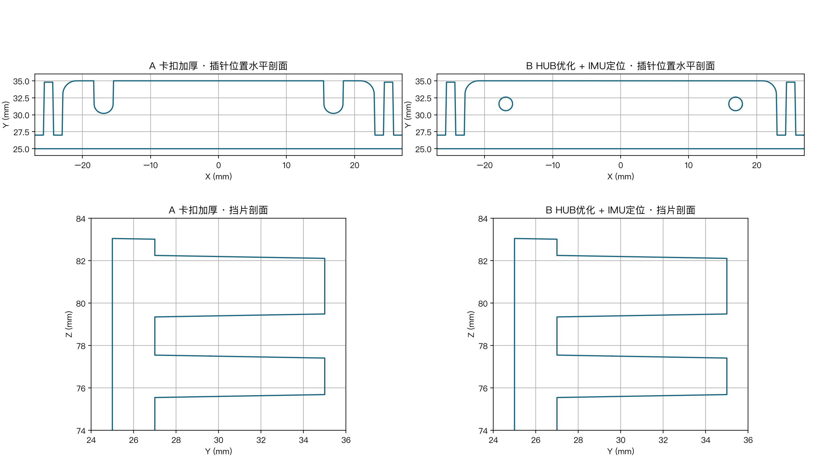
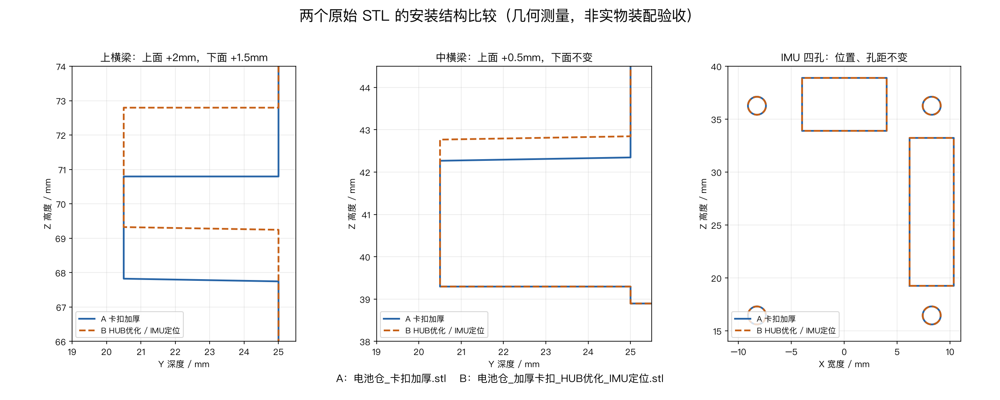

# banana PCB 与两款电池仓的安装匹配

## 结论

针对用户照片中**已焊好两只香蕉头和引出线的长条 banana PCB**，仅就取电板装入这一项，优先选择 `电池仓_卡扣加厚.stl` 的开口结构，而不是直接照用 `电池仓_加厚卡扣_HUB优化_IMU定位.stl` 的闭孔结构。两版上部安装横梁也有差异，不能据此认定整机安装完全等效；详见下方 HUB / IMU 比较。

这是对用户提供的两个 STL 做剖面比较得出的装入路径判断，**不是已完成实物试装**。尚需核对用户 PCB 厚度、香蕉头实际尺寸、焊点余量和打印误差。两根压板挡片都应保留。

## 实际检查的文件

目录：`/Users/I034198/Downloads/3D打印缝合怪版/stl模型/躯体部分/`

| 文件 | SHA-256 |
|---|---|
| `电池仓_卡扣加厚.stl`（A） | `66a40d4622763dc770de49834f70ad632034d927cb5f1fb03f815c78ad9d294e` |
| `电池仓_加厚卡扣_HUB优化_IMU定位.stl`（B） | `fab5d1753cdf96efd4d76ede48c781d651a895b84791dd1823bfccf8aabb87d3` |

两者整体包围盒均约为 **54.5 × 17.0 × 83.49mm**。STL 坐标按本打印项目的毫米单位解释。

## 几何差异

用 trimesh 读取原始 STL，检查 `Z=76.5` 的插针位置水平截面和 `X=12` 的压板挡片侧截面：

| 项目 | A：卡扣加厚 | B：HUB优化 / IMU定位 |
|---|---|---|
| 两个插针位置 | 向外敞开的 U 形槽 | 封闭圆孔 |
| 水平截面尺寸 | 圆弧底直径约 2.8mm；槽口约 2.92mm | 圆孔直径约 2.0mm |
| 插针中心距 | 33.8mm（X=±16.9） | 同为 33.8mm |
| 两根压板挡片 | 保留 | 保留，局部剖面与 A 基本相同 |
| 挡片与下方托台间隙 | 约 2mm | 同样约 2mm |
| 已焊插针侧向进入 | 有开口路径 | 插针被闭孔外侧材料挡住，不能照 A 的方式侧向装入 |

挡片根部/外端有斜度：`X=12` 剖面中，夹板间隙从根部约 1.80mm 增至外端约 2.08mm，不能把“约 2mm”当作全程恒定的净空。PCB、焊点和打印支撑仍可能产生干涉。

`community-kit` 的 banana PCB README 推荐 **2.5mm 香蕉头、总长 13mm、尾部 1.5mm（参考 U6068）**。2.0mm 闭孔不能让 2.5mm 插针主体直接穿过；但用户实际插针尺寸尚未测量，也未确认 B 版设计者对该孔的具体取电用途，不能仅凭孔径认定它一定是“螺丝取电专用”。

## A 版的装入逻辑

1. 电池取下，机器人及外部电源断开。
2. PCB 对齐两根压板挡片下方的夹板间隙，香蕉头朝向电池触点。
3. 从 U 槽开口侧沿 **PCB 短边/宽度方向**平移送入，而不是从挡片正上方压下。
4. 平移过程中，两只香蕉头沿 U 槽进入各自的圆弧底位置，PCB 同步进入挡片与托台之间。
5. 若阻力异常，停止并检查支撑残留、焊点、PCB 厚度和插针台阶；不硬掰挡片，不磨掉 PCB 铜箔。
6. 装好后应确认无明显松动、两只触点对齐，并在断电状态下核对极性、绝缘和无短路。

此结论只涉及取电板安装入口。kissqy 打印说明明确，其 IMU 安装结构配套作者 IMU，不能自动认定匹配本项目的 community-kit GD32 IMU。

## HUB / IMU 固定结构比较（补充检查）

**IMU 原有四孔定位没有移动；上部横梁有调整。** 文件名含“IMU定位”不等于四个安装孔移了位置，也不等于只有 B 才能固定 IMU。

坐标沿用原 STL：X 为电池仓宽度，Z 从底端向顶部取电板方向增加，Y 为前后方向。用 X=0 的纵剖面比较上部两道横梁，用 Y=25.5/26/27 的横截面核对 IMU 四孔：

| 项目 | A → B 的变化 | 对装配的意义 |
|---|---|---|
| IMU 四个安装孔 | 中心和孔径保持一致：X=±8.255mm，Z≈16.457/36.269mm；孔距约 **16.51 × 19.812mm**；模型孔径约 1.70mm | 换 A 不会丢失原有四孔，也不需要因这次换仓而平移 IMU 孔位 |
| IMU 背面贴合平面 | 都在 Y=25mm | 未看到为 IMU 整体新增垫高或改变贴合方向的设计 |
| 上横梁（靠取电板一侧） | 上表面沿 Z 加高 **2.0mm**；下表面沿 Z 抬高 **1.5mm** | 横梁本体厚度增加约 0.5mm，同时改变周边支撑和避让空间 |
| 中横梁（IMU 四孔区域上方） | 上表面沿 Z 加高 **0.5mm**；下表面不变 | 改变其上侧限位/间隙，并非平移下方 IMU 四孔 |
| 两横梁之间净距 | 中央剖面同一深度处增加约 **1.0mm** | B 与 A 的局部夹持空间不完全相同 |

例如 X=0、Y=23mm 处：A 的上横梁下表面约 Z=67.781mm，中横梁上表面约 Z=42.311mm，净距约 25.470mm；B 对应约 69.281mm、42.811mm，净距约 26.470mm。

上部横梁调整可用于解释“HUB优化”版的局部安装空间差异，但**不能把上横梁加高 2mm 直接说成“HUB PCB 中心整体抬高 2mm”**。尚未将用户实际 HUB 板形、孔位、焊点和连接器叠合到 STL 中确认装配。没有源设计说明时，也不把中横梁的 0.5mm 改动强行认定为某一元件的专用定位结构。

实用选择：

- 若只需解决已焊 banana 板的侧向装入，A 有现成开口；IMU 四孔布局与 B 相同。
- 若用户已验证 B 的 HUB 安装空间合适，可考虑**保留 B，仅将顶部两处取电孔改为 A 的 U 形开口**，避免把上部横梁调整也一起回退。这是后续修改方案，当前未修改原始模型，也未生成该混合版本。
- 用户的 community-kit GD32 IMU 是否与此 16.51 × 19.812mm 四孔匹配，仍应以实际板卡孔距为准，不从“IMU定位”文件名推断。

交叉参考：`reference/microduck-kissqy/docs/assembly-electronics.js` 将 IMU 放在下部背板四孔区域，并注明背面贴合平面为原始 Y=25mm；本次孔坐标以用户提供 STL 的直接截面测量为准，而不是采用网页展示代码中的近似值。

## 前序判断纠正

- 用户实物照片中的 PCB 尚顶在挡片上方；不能据此建议剪掉挡片。
- 两款 STL 均为一个连通实体，顶部横条在这两个文件中不是独立可拆锁扣。“先拆横条”不适用于这两个原样打印件。
- 本次确认关键是 **U 形开口与封闭孔的区别**，而非“其中一版没有挡片”。

参考：[community-kit banana PCB 说明](../reference/microduck-community-kit/hardware/banana_pcb/README.md)、[缝合怪打印件说明](../reference/microduck-kissqy/hardware/3d-print-frankenduck/README.md)。未修改两个原始 STL。
