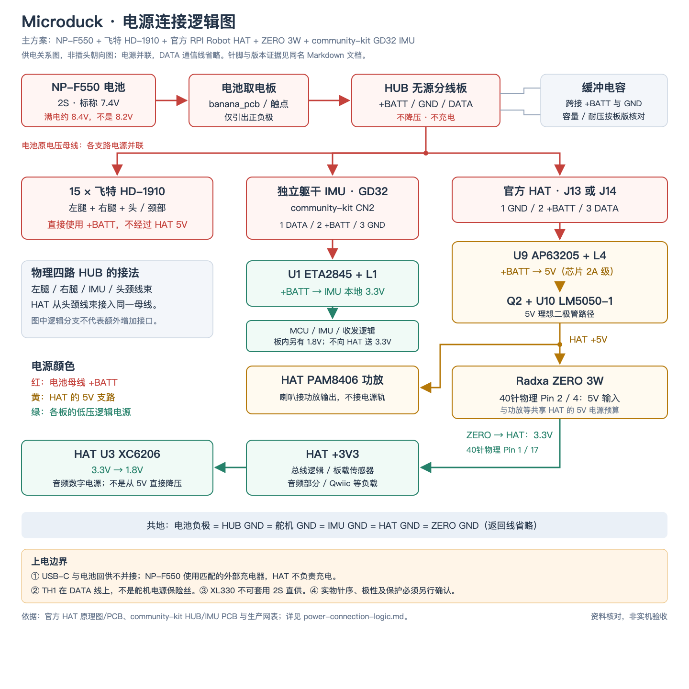
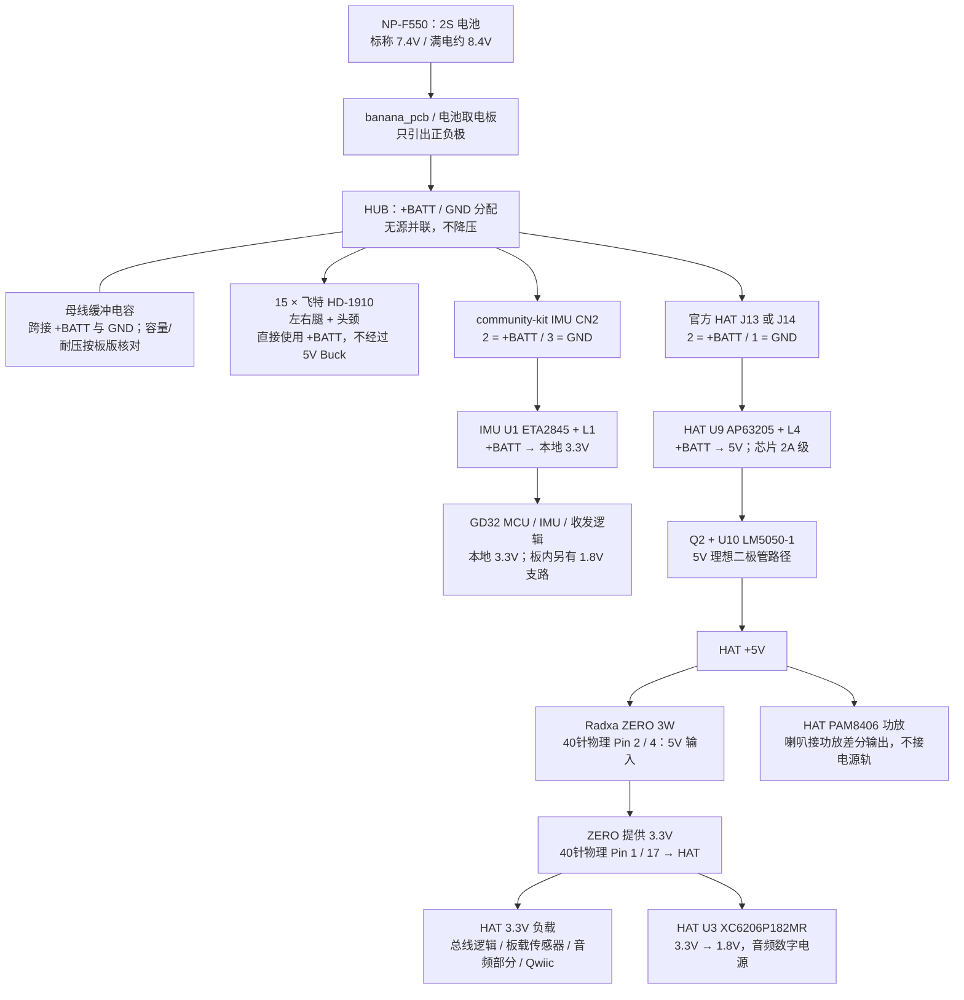

# Microduck 电源连接逻辑图

> 依据 `reference/` 本地仓库的原理图、PCB 网络和硬件说明整理，不是实机电气验收记录。
> 主图按本项目已记录的 **NP-F550 + 飞特 HD-1910 + 官方 RPI Robot HAT + Radxa ZERO 3W + community-kit GD32 IMU** 组合整理。
> 图中箭头表示供电方向，不表示接口朝向；不同版本的针脚不能混用。



[PNG 图片](power-connection-logic.png) · [SVG 矢量图](power-connection-logic.svg)

## 1. 一句话结论

**电池先进入取电板和 HUB，HUB 分配电池原电压：舵机直接用这路电，IMU 自己降压，HAT 降到 5V 供 ZERO 3W；ZERO 再通过 40 针接口提供 3.3V 给 HAT。**

- `+BATT` / `VBATT` / `VDD_BUS` 在本文主图中指同一条电池母线，不是 5V。
- NP-F550 为 2S 锂电，标称 7.4V，满电约 8.4V。软件中的 6.6V、8.2V 等电量映射参数不是电池的硬件电压限制。
- HUB 是无源并联分线板，**不降压、不充电**；缓冲电容跨接 `+BATT` 与 `GND`，不串在电源线上。
- **15 颗舵机的电流不经过 HAT 的 AP63205 5V 降压器。** 该降压器供应主控和 HAT 的 5V 负载。
- 主图是电气逻辑，不等同于“需要给 HUB 接五条支路”。实际四路 HUB 的头/颈部线束同时延伸至 HAT，见第 3 节。

## 2. 完整电源逻辑（可编辑 Mermaid）



**共地回路：** 电池负极、HUB GND、各舵机 GND、IMU GND、HAT GND、ZERO GND 全部连通。图中为了清晰未画出每根返回线。独立 IMU 的本地 3.3V 不应另外接到 HAT 的 3.3V 轨上。

### HAT 三条关键电源路径

| 电源路径 | 方向与用途 | 核对依据 |
|---|---|---|
| 电池母线 | J13/J14 pin 2 ↔ `+BATT`，直接连 U9 输入，也直接连其他舵机电源口 | HAT PCB：J13.2、J14.2、U9.3 同为 `+BATT` |
| 主控 5V | `+BATT` → U9/L4 → Q2/U10 → `+5V` → J4 pin 2/4 → ZERO | HAT `power.kicad_sch`、PCB |
| HAT 3.3V/1.8V | ZERO → J4 pin 1/17 → `+3V3`；`+3V3` → U3 → `+1V8` | HAT PCB：U3.3=`+3V3`，U3.2=`+1V8` |

AP63205 标称 2A 不等于“ZERO 可独占 2A”，更不等于“整机舵机电流上限 2A”。功放等负载共享 5V 支路，实际可用电流还受散热、输入电压和布线限制。

## 3. 实际线束如何连接

community-kit README 给出的物理分支是：

```text
NP-F550
  └─ 香蕉触点 / banana_pcb
       └─ 两根电源线（+BATT、GND）→ dxl_hub 电池入口
            ├─ 三芯总线 → 左腿舵机链
            ├─ 三芯总线 → 右腿舵机链
            ├─ 三芯总线 → 头/颈部线束 → HAT 的 J13 或 J14
            └─ 三芯总线 → 躯干 IMU CN2

HAT 的 J4（40针）↔ ZERO 3W
  ├─ HAT → ZERO：5V，物理 Pin 2/4
  ├─ ZERO → HAT：3.3V，物理 Pin 1/17
  └─ 共地；另有 UART、I²C、音频等信号
```

- 三芯总线包含 **电源正极、地、DATA**；DATA 是通信线，不是另一条电源线。
- 头/颈部的具体串接顺序由线束、舵机双接口和安装位置决定；上图不指定哪颗舵机必须接 HAT。
- 线缆可以逐颗“串接”，但各负载的电源关系是**并联**，不是将电压逐颗分配。
- HAT 的 J13/J14 电气并联，不区分专用“电源输入口”和“舵机输出口”。不要让腿部大电流绕经头部细线再返回 HUB；电池应在躯干 HUB 处注入。

## 4. 针脚对照：按网络连接，不按颜色或外观猜

### 当前主图组合

| 板卡 / 接口 | Pin 1 | Pin 2 | Pin 3 | 说明 |
|---|---|---|---|---|
| 官方 HAT J13/J14 | GND | +BATT | DATA | 两口并联；非 RS-485 四针口 |
| community-kit IMU CN2 | DATA | +BATT | GND | PCB 和生产 `netlist.ipc` 一致 |
| community-kit HUB CN1/3/5/7 | GND | +BATT | DATA | EH 一组焊位 |
| community-kit HUB CN2/4/6/8 | DATA | +BATT | GND | 飞特侧一组焊位；实装座型以板子为准 |
| community-kit HUB J3 电池入口 | +BATT | GND | — | 注意：与 fanduck J5 的针序不同 |

HAT 直接连接上述 IMU 时，电气映射是：

```text
HAT J13/J14.1（GND）   → IMU CN2.3（GND）
HAT J13/J14.2（+BATT） → IMU CN2.2（+BATT）
HAT J13/J14.3（DATA）  → IMU CN2.1（DATA）
```

这说明的是**针号映射**，不意味着所有成品线都必须剪开交叉。必须先断电，用万用表确认已有线束两端的真实对应关系。

ZERO 的 GND 可核对物理 Pin 6/9/14/20/25/30/34/39；这里所有 Pin 数字均为 **40 针物理序号，不是 GPIO 编号**。

## 5. 不同参考仓库的版本差异

| 参考方案 | 电源拓扑 / 器件 | 不可混用之处 |
|---|---|---|
| **官方 HAT + community-kit（主图）** | HUB 无源分配；GD32 IMU 用 ETA2845 降至 3.3V；官方 HAT 用 AP63205 降至 5V | community IMU CN2 为 DATA/+BATT/GND；它不是 STM32/HT7533 IMU |
| **microduck-replica 新版 1V0A** | `wire_hub` 无源；STM32 IMU 用 HT7533-1 LDO，具有 F1/TVS 输入保护设计 | IMU J1=DATA/VDD/GND，J2=GND/VDD/DATA；HUB 两组接口针序不同。README 标注尚未完成对应实物验证 |
| **microduck-kissqy** | 同样是 HUB 分配电池电压、HAT 降压；HUB 带 1000µF 电容 | HUB V1 电源输入 XH2.54；V3（2026-11-14）改为 AMP2.0。旧 `ASSEMBLY-NOTES.md` 仍描述 V1。IMU 2026-11-13 修改过封装针位，不能套 community CN2 表 |
| **fanduck DCHUB v1.1** | 四口无源并联，470µF/16V 电容；无稳压、保险丝、反接或过流保护 | 四个 X3P：1=GND、2=VBATT、3=DATA；电池入口 J5：1=GND、2=VBATT；并非 community HUB J3 针序 |
| **xgoduck_hardware / ArduinoUnoQ V1.1** | 独立主板/电池/充电方案，文档要求充电时关闭电源开关 | 不属于本主图；不得把其充电口、开关或针号套到官方 HAT 上 |

community-kit HUB 当前 PCB 的 C1 标为 **1000µF/10V 固态**；fanduck 为 **470µF/16V**；kissqy 文档为 **1000µF**。这些是不同板子的配置，不应统一写成一个规格。满电 8.4V 与舵机再生/线缆瞬态需要另行评估，电容存在不代表能保证 ZERO 不重启。

## 6. 上游旧图的勘误

`microduck-replica/assets/hw/02-电源分配.png` 和 `02b-供电与保护.png` 可帮助理解整体，但不能直接当作接线依据：

1. **TH1 不在舵机正极线上。** 官方 HAT PCB 中 TH1 连接的是 DATA 路径，J13.2/J14.2 直接接 `+BATT`。旧图的“舵机经 TH1 100R”表述错误；它不能为舵机供电提供过流保护。
2. **音频 1.8V 的输入是 3.3V，不是 5V。** 官方 HAT U3（XC6206P182MR）输入 pad 3 接 `+3V3`，输出 pad 2 接 `+1V8`。
3. **community-kit IMU 的 F1 同样位于 DATA 线上。** 其 PCB：F1.1=`/DATA`，F1.2 接数据保护网络；U1.5 直接接 `+BATT`。不要套用 replica STM32 IMU 的“电源串联 PPTC”描述。
4. **8.2V 不是 2S 电池满电的硬件上限。** 接线与耐压检查应考虑约 8.4V 满电以及瞬态。
5. 仓库虽有 `pwr_supply_charge.kicad_sch`，当前主层级 `main.kicad_sch` 实际引用的是 `power.kicad_sch`，不能仅凭文件名认定 HAT 支持充电。

## 7. 上电和充电边界

- **只给 ZERO 插 USB-C，不等于给舵机/躯干 IMU 供电，也不会给 NP-F550 充电。** 电池母线与 5V 支路不是同一条线。
- 按本项目已有 ZERO 3W 装配约束，**USB-C 供电与 HAT 电池回供二选一**。HAT 的 LM5050 不是整套主控 USB-C 的电源仲裁器，不能据此认定双电源并接安全。
- NP-F550 使用匹配的外部充电器，充电时与机器人断开；不要向 HAT 舵机口接“充电电压”尝试充电。
- **HD-1910 与 XL330 不能共用“2S 直供安全”的结论。** 本地 HD-1910 资料给出上限 8.4V，满电已到上限，仍需检查瞬态；XL330 公开输入范围为 3.7–6.0V，不应直接接满电 2S。XL330 需要另行设计匹配的舵机降压路径，不能改用 HAT 的小功率 5V 支路替代整机电源。
- 整机允许输入电压由所有负载中最严格的规格决定，**不是 HAT README 的 5–28V，也不是 community IMU 的 5–36V**。
- 初检断开全部电源、舵机及外设，核实极性、针序和无低阻短路；再分板限流测试，测出 HAT 5V、ZERO 3.3V、IMU 本地 3.3V，最后逐步接入负载。小电流单板试验限流值不能直接当作 ZERO/整机的启动供电能力。
- 主电池支路的保险丝、总开关/快速断电装置应按实际电池、导线、接口和峰值负载设计；**本图没有假定这些保护已经存在**。软件急停不等于物理断电。

## 8. 来源与证据范围

| 编号 | 本地参考文件 | 用于确认 |
|---|---|---|
| S1 | [`elec_RPI_Robot_HAT/README.md`](../reference/elec_RPI_Robot_HAT/README.md)、[`power.kicad_sch`](../reference/elec_RPI_Robot_HAT/power.kicad_sch)、[`main.kicad_sch`](../reference/elec_RPI_Robot_HAT/main.kicad_sch)、[`PCB`](../reference/elec_RPI_Robot_HAT/elec_RPI_Robot_HAT.kicad_pcb) | 输入、Buck/理想二极管、J4/J13/J14、TH1、U3 电源网络 |
| S2 | 官方 HAT [`C1 发布原理图`](../reference/elec_RPI_Robot_HAT/production/_old/ASE01187-C1_elec_RPI_Robot_HAT_SCH.pdf) 与 [`D1 发布原理图`](../reference/elec_RPI_Robot_HAT/production/ASE01187-D1_elec_RPI_Robot_HAT_SCH.pdf) | 电源、40针、舵机和音频页交叉检查；C1 文件内部部分标题栏仍为 B1，不据此认定实板版本 |
| S3 | [`community-kit README`](../reference/microduck-community-kit/README.md)、[`HUB PCB`](../reference/microduck-community-kit/hardware/dxl_hub/dxl_hub.kicad_pcb) | 电池—取电板—HUB—四支路；电池入口、两组针序及电容 |
| S4 | [`community IMU README`](../reference/microduck-community-kit/hardware/imu_to_dxl/README.md)、[`PCB`](../reference/microduck-community-kit/hardware/imu_to_dxl/imu_to_dxl.kicad_pcb)、[`生产网表`](../reference/microduck-community-kit/hardware/imu_to_dxl/production/netlist.ipc)、[`BOM`](../reference/microduck-community-kit/hardware/imu_to_dxl/production/bom.csv) | CN2 针序、ETA2845 3.3V、ME6211 1.8V、F1 位于 DATA |
| S5 | [`replica 新版硬件`](../reference/microduck-replica/hardware/新版/README.md)、[`硬件方案逆向`](../reference/microduck-replica/docs/硬件方案逆向.md) | STM32/LDO 版本差异、HD-1910 电压资料 |
| S6 | [`kissqy 硬件说明`](../reference/microduck-kissqy/hardware/README.md)、[`装配提醒`](../reference/microduck-kissqy/docs/ASSEMBLY-NOTES.md) | HUB V1/V3 接口变更、电容、IMU 接口版本 |
| S7 | [`fanduck DCHUB v1.1`](../reference/fanduck/hardware/dchub-v1.1/README.md) | 无源分线、电容、J5 针序及保护边界 |
| S8 | [`XGO ArduinoUnoQ V1.1`](../reference/xgoduck_hardware/PCBA/README_CN.md) | 独立充电方案，不与本图混用 |
| S9 | 本项目 [`装配记录`](../working-docs/assembly-bringup-2026-10-12.md)、[`IMU/HAT/ZERO/URT-2 说明`](../working-docs/imu-hat-zero3w-urt2-guide.md) | 主图硬件组合、ZERO 3W 单电源约束；不是上游器件规格证据 |

本次读取的本地 HEAD：`elec_RPI_Robot_HAT 6de8628`、`microduck-community-kit c024861`、`microduck-replica 1ae1a89`、`microduck-kissqy 0ce34b0`、`fanduck eb88379`、`xgoduck_hardware 4496fad`。资料更新后需重新核对。

**尚未验证：** 用户手中每块板的实际版本、线束颜色/压接、接口朝向、整机峰值电流、连接器温升、母线瞬态及双电源隔离。接线前必须对实物确认，本文不替代这些检查。
